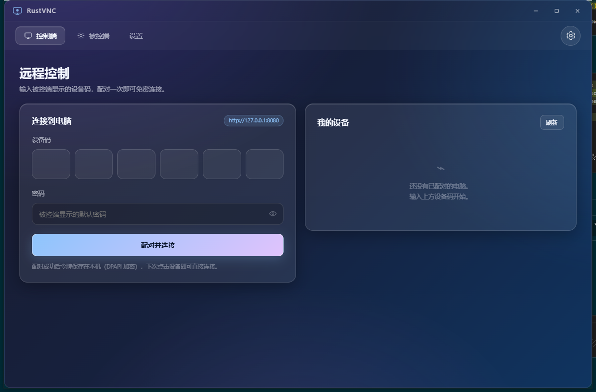
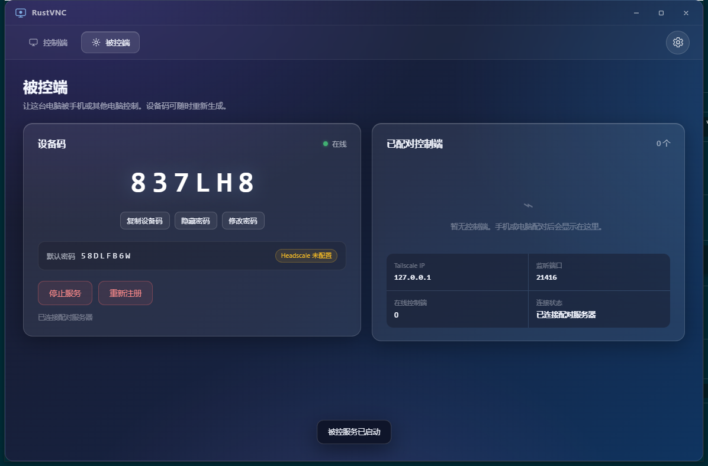
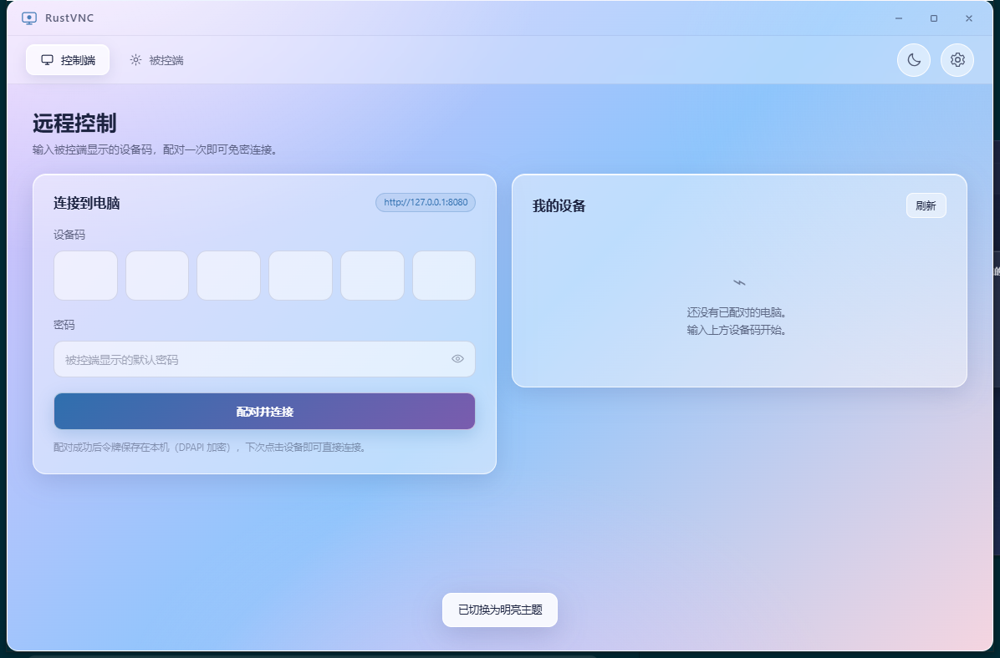
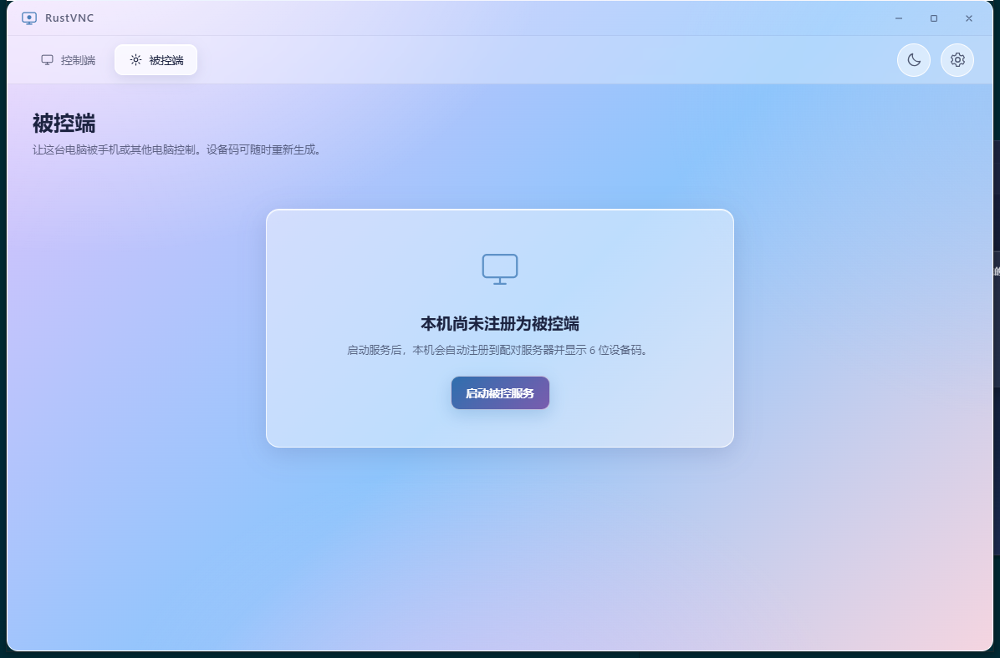

# RustVNC

[](https://github.com/yuos-bit/rust-vnc/actions/workflows/release.yml)

**异地组网远程控制（手机控电脑）** — Tailscale 风格的加密虚拟组网 + 端到端远程桌面。

RustVNC 把网络层直接内置到客户端：PC 端通过 Go `tsnet` sidecar 加入自建 Headscale/DERP 网络，Android 端通过官方 Tailscale 网络栈加入同一张网；配对后控制端直接连接被控端的 `100.x` 地址，服务器不中转业务数据。

> 本仓库是完整可运行的 MVP。桌面端、配对后端、Web 管理台均使用 Rust 构建并通过本机编译与集成测试；Android 端提供完整源码脚手架，需要本机 Android SDK/JDK 与 Go/gomobile 才能打包（当前环境未安装）。
>
> GitHub Actions 会自动构建 Android 与 Windows 端并发布 Release：首次发布 `v0.1.0`，之后每累计 10 次提交发布一次（`v0.1.1`、`v0.1.2`…）。详见 [docs/RELEASING.md](docs/RELEASING.md)。

---

## 1. 功能

- **6 位设备码 + 密码配对**，设备码字符集排除易混淆字符（`0/O/1/I/L`）
- **免密令牌**：配对一次后长期有效，可在被控端或 Web 后台吊销
- **防暴力枚举**：Argon2id 密码哈希、恒定时间比较、按设备码 + 来源 IP 的双层滑动窗口限流与锁定
- **端到端加密通道**：控制流量走 Tailscale/WireGuard 虚拟网；自建 DERP 仅在打洞失败时中继
- **原始分辨率采集**，控制端按原宽高比等比显示（`object-fit: contain`），绝不拉伸
- **完整键鼠注入**：Windows `SendInput`，支持鼠标移动/按键/滚轮/侧键、物理键码映射与 Unicode/IME 文本
- **Windows DPAPI** 加密保存设备身份与免密令牌
- **毛玻璃 + 卡片动画** 的 PC、Web 管理台与 Android UI，右上角统一设置齿轮
- **暗黑 / 明亮主题一键切换**（右上角太阳/月亮按钮），选择持久化到本机设置
- 配对后端集成 **Headscale REST API**：被控端注册时自动签发 Pre-Auth Key；控制端可通过 `/api/v1/controllers/enroll` 一键获取入网密钥

---

## 2. 架构

```text
                    ┌──────────────────────────────┐
                    │  配对后台 rv-server (Rust)    │
                    │  Axum + SQLite + Web 管理台   │
                    └───────┬──────────────┬───────┘
                 REST API   │              │  REST + API Key
                            │              ▼
                            │      ┌───────────────┐
                            │      │ Headscale     │
                            │      │ (控制面)       │
                            │      └───────┬───────┘
                            │              │
        ┌───────────────────▼──┐      ┌────▼─────────────┐
        │  PC 被控端 (Tauri)    │      │ DERP (自建中继)   │
        │  rv-engine agent      │      └────┬─────────────┘
        │  屏幕采集 + 输入注入   │           │
        └──────────┬───────────┘           │
                   │  tsnet sidecar (Go)   │
                   │  SOCKS5 / 入站转发     │
        ───────────┼───── WireGuard 加密隧道 ───────────
                   │                       │
        ┌──────────▼───────────┐  ┌────────▼─────────────┐
        │ PC 控制端 (Tauri)     │  │ Android 控制端        │
        │ rv-engine controller  │  │ Compose + VpnService │
        └──────────────────────┘  └──────────────────────┘
```

**控制会话**：控制端先用配对令牌向后台 `/api/v1/connect` 换取被控端 `100.x:21416`，然后在 Tailscale 隧道内建立一条双向 TCP 流。帧格式为 `u32_le 长度 || bincode(消息)`，视频为 JPEG 帧，输入为鼠标/键盘事件。被控端在握手时再次向后台校验令牌，失败即关闭（fail closed）。

---

## 3. 目录结构

```text
crates/
  rv-core/      设备码、Argon2、令牌、限流、等比几何
  rv-proto/     配对 API DTO + 控制协议（bincode 2）
  rv-net/       直连 / SOCKS5 传输、Tailnet 地址校验
  rv-capture/   Windows GDI 原始分辨率采集 + 等比 JPEG 编码
  rv-input/     Windows SendInput 注入 + DOM 键码映射
  rv-engine/    被控端 / 控制端会话引擎、配对 API 客户端
  rv-server/    配对后台 + Headscale 客户端 + 内嵌 Web 管理台
apps/
  pc/           Tauri 2 桌面端（控制端 + 被控端 + 会话界面）
  tsnet-sidecar/ Go tsnet 边车（SOCKS5 + 入站转发）
android/        Jetpack Compose 控制端源码脚手架
deploy/         Headscale / DERP / rv-server 容器化部署
docs/           API 与部署文档
scripts/        图标生成、冒烟测试
```

---

## 4. 快速开始（本机三进程）

需要 Rust 1.99+、Windows 10/11、WebView2（Win10/11 自带）。

### 4.1 启动配对后台

#### Docker Compose 一键启动（推荐，需要 Docker + Compose v2）

```powershell
# Windows
.\scripts\start-pairing-backend.ps1

# Linux / macOS
./scripts/start-pairing-backend.sh
```

脚本会创建 `deploy/pairing/pairing.env`、生成随机管理员令牌、构建并启动 `rv-server`，等待健康检查后打印管理台地址和令牌。默认只监听 `127.0.0.1:8080`；详细配置（端口、Headscale、数据卷、备份）见 [deploy/pairing/README.md](deploy/pairing/README.md)。

#### 本机无 Docker 时

```powershell
$env:RV_ADMIN_TOKEN = "dev-admin-token-please-change"
$env:RV_DB = "data/rvnc.db"
cargo run -p rv-server
```

控制台会打印 `http://127.0.0.1:8080/admin/` 与管理员令牌。浏览器打开管理台即可查看设备、令牌、配对记录与 Headscale 配置。

> 未配置 Headscale 时，配对功能仍可用；被控端可以在设置中手工填写 Tailscale IP，或仅供本机直连测试。生产部署见 [docs/DEPLOYMENT.md](docs/DEPLOYMENT.md)。

### 4.2 启动 PC 桌面端

```powershell
cargo run -p rv-pc
```

1. 打开右上角齿轮，把「配对服务器」设为 `http://127.0.0.1:8080`（默认已是该值），保存。
2. 切换到 **被控端**，点击「启动服务」。首次启动会注册设备并显示 6 位设备码与默认密码。
3. 在同一台或另一台电脑启动本程序，切换到 **控制端**，输入设备码和密码，点击「配对并连接」。
4. 配对成功后自动保存令牌并进入会话；之后点击设备列表即可免密连接。

本机联调时，被控端监听 `127.0.0.1:21416`，控制端在设置里保持 `direct` 即可。跨机生产环境使用 `socks5://127.0.0.1:1055`（tsnet sidecar）并部署 Headscale/DERP。

### 4.3 tsnet sidecar（Linux/Windows 通用）

```bash
cd apps/tsnet-sidecar
go build -o rvnc-tsnet .
TS_AUTHKEY=tskey-auth-... TS_HOSTNAME=rvnc-a2b3c4 ./rvnc-tsnet
```

sidecar 会把 tailnet 的 `:21416` 转发到本机 Rust 被控端，并在 `127.0.0.1:1055` 提供 SOCKS5。详见 [apps/tsnet-sidecar/README.md](apps/tsnet-sidecar/README.md)。

### 4.4 Android

见 [android/README.md](android/README.md)。需要 Android Studio、JDK 17、SDK 35，以及用 Go/gomobile 构建的 Tailscale AAR。

### 4.5 本地构建时内置 `.env`（可选）

仓库根目录的 `env-back` 是**客户端配置模板/示范文件**，构建脚本不会自动读取它。需要把配置内置到客户端时，请手动复制并填写：

```powershell
# Windows PowerShell
Copy-Item env-back .env
# 编辑 .env：填写真实的 Headscale 地址、DERP 地址、headscale-key

# Linux / macOS
cp env-back .env
```

然后**重新编译**目标端；构建时才会读取 `.env`，修改配置后必须重新编译才会生效，已经生成的 exe/APK 不会自动更新：

```powershell
# Windows release
cargo build --release -p rv-pc
# 产物：target/release/rustvnc.exe
# 应用内：设置 → 内置配置（.env）

# Android（需要 JDK 17 / Android SDK 35 / Gradle 8.10.2）
bash .github/scripts/ensure-android-keystore.sh   # 生成本地自签名 keystore
gradle -p android :app:assembleRelease :app:bundleRelease
# 产物：android/app/build/outputs/apk/release/app-release.apk
```

说明：

- `env-back` 是仓库中的示例模板，使用占位符；`.env` 是本机真实配置，已被 `.gitignore` 忽略，**不要提交**。
- 构建脚本只读取 `.env`，**不会读取 `env-back`**；不复制/不创建 `.env` 时，产物中不会包含这些配置。
- 修改 `.env` 后必须重新编译；只重启应用不会更新已内置的内容。
- PC 与 Android 的设置页都会显示“内置配置（.env）”，敏感值默认隐藏。
- CI 检出没有 `.env`（被 `.gitignore` 忽略），自动发布产物不包含 Headscale/DERP/key；需要内置配置时在本地编译。
- Windows 中文路径下，`android/gradle.properties` 已设置 `android.overridePathCheck=true` 以通过 AGP 路径检查。
- **安全**：配置会编译进 exe/APK，任何人都能提取；请勿公开分发包含生产密钥的构建。

---

## 5. 服务端环境变量

| 变量 | 默认值 | 说明 |
| --- | --- | --- |
| `RV_BIND` | `0.0.0.0:8080` | 监听地址（生产建议只监听内网，由 Caddy 终止 TLS） |
| `RV_DB` | `data/rvnc.db` | SQLite 路径 |
| `RV_ADMIN_TOKEN` | 自动生成并打印 | 管理台/管理 API 的 Bearer 令牌 |
| `RV_TRUST_PROXY` | 关闭 | 为 `1` 时信任 `X-Forwarded-For`（仅放在可信反代后） |
| `HEADSCALE_URL` | 空 | 例如 `http://headscale:8080` |
| `HEADSCALE_API_KEY` | 空 | Headscale API Key（仅服务端持有） |
| `HEADSCALE_USER` | `1` | 签发 Pre-Auth Key 使用的用户 ID |
| `HEADSCALE_CONTROL_URL` | 回退到 `HEADSCALE_URL` | 客户端 `tsnet` 使用的控制面地址 |
| `DERP_URL` | 空 | 下发给客户端的 DERP 地址 |
| `AGENT_PORT` | `21416` | 被控端 tailnet 端口 |
| `TOKEN_TTL_DAYS` | `30` | 免密令牌有效期 |

管理台中的设置优先于环境变量（环境变量只在首次启动时写入数据库）。

---

## 6. 安全设计

- 密码使用 **Argon2id** + 随机盐；数据库中不保存明文密码。
- 设备码/密码错误统一返回 `401` 与同一文案，未知设备也会执行一次等价 Argon2 校验，避免时序枚举。
- 令牌 32 字节随机，数据库仅存 SHA-256 摘要；可被被控端或管理员即时吊销。
- 被控端每次建立会话都向配对后台重新校验令牌，后台不可达时拒绝连接。
- 设备身份文件与免密令牌使用 **Windows DPAPI（当前用户范围）** 加密。
- 管理 API 使用恒定时间比较的 Bearer 令牌；`/api/admin/login` 不返回任何设备数据。
- 控制流量只应在 Tailscale 隧道内可达；默认监听 `127.0.0.1`，由 sidecar 转发。
- 生产必须使用 HTTPS（Caddy/nginx），限制 `/admin` 来源 IP，并设置 ≥32 字符的管理员令牌。

---

## 7. 实现状态与已知边界

| 能力 | 状态 |
| --- | --- |
| 配对后台、设备/令牌/记录/设置 API | ✅ 已实现，15 项端到端冒烟测试通过 |
| Web 管理台（毛玻璃、右上角齿轮） | ✅ 已实现，静态路由与 API 已验证 |
| PC 被控端：GDI 采集、JPEG、SendInput | ✅ 已实现（Windows），真实截屏会话测试通过 |
| PC 控制端：配对、连接、等比渲染、键鼠 | ✅ 已实现，已在应用内完成配对 → 连接 → 实时画面全流程 |
| 免密令牌、吊销、DPAPI 存储 | ✅ 已实现 |
| Headscale Pre-Auth Key / 节点地址解析 | ✅ 已实现（需真实 Headscale 验证） |
| tsnet sidecar 源码 | ✅ 已提供（本机无 Go，未编译验证） |
| Android Compose 客户端 | 🧩 源码脚手架（本机无 Android SDK，未编译） |
| 内嵌 Tailscale Android AAR | 🧩 需按 README 用 gomobile 构建 |
| RustDesk 引擎原样移植 | 🧩 当前为自研等价传输层（GDI + JPEG + SendInput），接口已隔离在 `rv-capture` / `rv-input` / `rv-engine`，便于替换为 RustDesk 模块 |

### 界面预览

| 控制端（暗黑） | 被控端（暗黑） |
| --- | --- |
|  |  |

| 控制端（明亮） | 被控端（明亮） |
| --- | --- |
|  |  |

> 截图来自本机实际构建运行（测试设备码与密码数据已清除）。点击右上角太阳/月亮图标即可切换主题。

**关于 RustDesk**：本实现没有直接 vendor RustDesk 源码（其 AGPL-3.0 体积庞大且需要其完整构建链）。屏幕采集、编码、输入注入与传输被拆分到独立 crate，后续可在不改动 UI/配对层的前提下替换为 RustDesk 的采集、编码与传输模块。分发本衍生作品时请遵循 AGPL-3.0。

**关于 Android**：Android 端采用 Kotlin 实现 bincode 2 线协议解码与 Compose UI；Tailscale 网络栈需要官方 AAR/gomobile 产物，仓库中已给出接入接口与构建说明，但当前环境无法编译验证。

---

## 8. 测试与审计

```powershell
cargo test --workspace
cargo clippy --workspace --all-targets
cargo audit
```

本机已验证（2026-10-18）：

- `cargo test`：36 项通过，1 项桌面截屏测试默认忽略；该测试单独运行同样通过。
- `cargo clippy --all-targets`：0 warning / 0 error。
- `scripts/smoke-test.sh`：15/15 通过（注册、心跳、错误密码、配对、连接、会话校验、控制端入网、管理 API、吊销、吊销后拒绝）。
- `cargo audit`：0 个漏洞；3 条警告（`bincode` 已停止维护、`proc-macro-error` 已停止维护、Linux GTK 依赖 `glib` 的 soundness 公告，Windows 构建不启用该依赖）。
- 桌面端 UI 端到端：启动被控服务 → 显示设备码/密码 → 同机控制端配对 → 免密连接 → 1920×1080 画面按比例显示。

完整记录见 [CHANGELOG.md](CHANGELOG.md)。

---

## 9. 自动构建与发布

- 工作流：[`.github/workflows/release.yml`](.github/workflows/release.yml)
- 触发：push 到 `main`，或手动运行（可勾选 `force` 立即发布）。
- 规则：无 tag 时首发 `v0.1.0`；之后距最新 tag 累计 **10 次提交**时自动发布，补丁号 +1。
- 构建：Android 已签名 APK + AAB、Windows x64 桌面端 zip；两个平台都成功后才创建 tag 与 GitHub Release。
- 签名：自动生成自签名 Android 证书并存入 Actions 私有缓存；证书 SHA-256 指纹写入 Release 说明。生产环境可通过 Secrets 固定密钥。
- 版本注入：Android `versionName`/`versionCode`、Rust workspace 版本、Tauri 版本在 CI 中统一为同一次发布的版本号。

完整说明（证书、Secrets、手动发布、故障排查）见 [docs/RELEASING.md](docs/RELEASING.md)。

---

## 10. 协议与文档

- [docs/API.md](docs/API.md) — 配对/管理 API 与控制线协议
- [docs/DEPLOYMENT.md](docs/DEPLOYMENT.md) — Headscale + DERP + 反向代理部署
- [docs/RELEASING.md](docs/RELEASING.md) — GitHub Actions 自动构建、版本与签名
- [CHANGELOG.md](CHANGELOG.md) — 变更记录与审计结果
