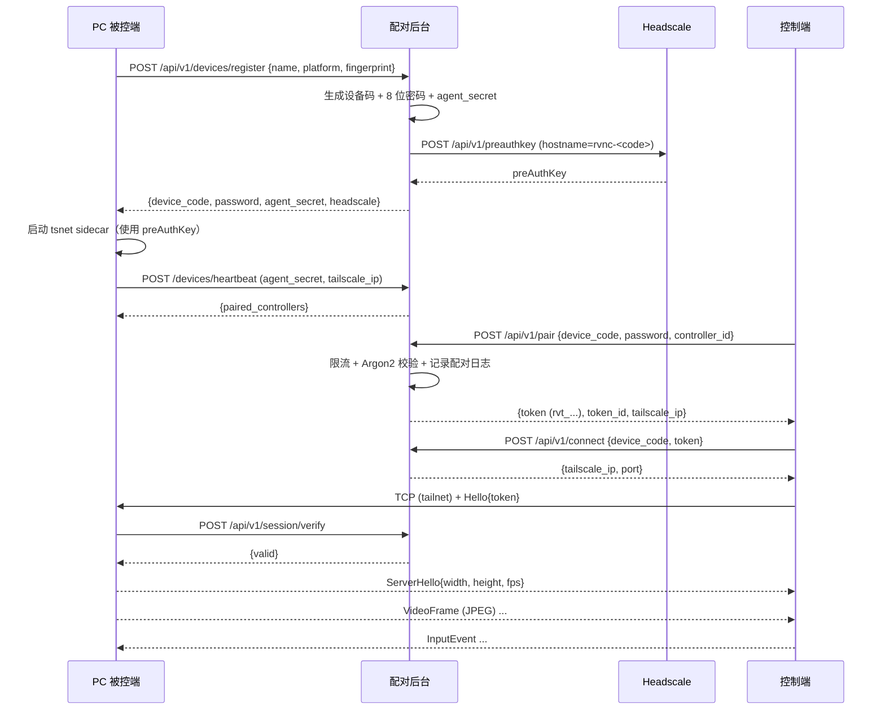

# 架构与威胁模型

本文补充 [README](../README.md) 与 [CLAUDE.md](../claude.md) 未展开的实现细节，供后续维护与安全评审使用。

## 1. 信任边界

```text
[控制端] --HTTPS--> [配对后台] <--HTTP/API Key--> [Headscale]
    |                    ^
    |  WireGuard 隧道     | 仅控制面
    v                    |
[被控端] <--- P2P / DERP 加密中继 ---> [控制端]
```

- **配对后台**：公网可达，持有 Headscale API Key、设备密码哈希、令牌摘要。它永远不下发设备密码明文（注册响应除外，且仅返回一次）。
- **Headscale**：只负责节点注册与网络协调，不接触业务数据。
- **DERP**：只转发 WireGuard 密文。
- **被控端**：默认监听 `127.0.0.1:21416`，由 tsnet sidecar 在 tailnet 内暴露端口；即使端口被误暴露到公网，也必须通过令牌校验才能建立会话。
- **控制端**：持有免密令牌（DPAPI 加密）。令牌泄露等同于该设备对该被控端的访问权，可在被控端或管理台吊销。

## 2. 配对流程



## 3. 控制线协议

- 传输：Tailscale 隧道内的单条 TCP 双向流（`21416`）。
- 帧：`u32 little-endian 长度` + `bincode 2 (standard config)` 消息体；上限 16 MiB。
- 握手：`Hello` 携带设备码、令牌、控制端 ID；被控端向后台校验后才发送 `ServerHello`。
- 心跳：控制端每 5 s 发送 `Ping`；被控端 30 s 无消息即断开。
- 视频：JPEG，`seq` 单调递增；控制端在 UI 队列满时丢弃新帧，避免延迟累积。
- 输入：归一化坐标 `0..1` 覆盖采集到的虚拟桌面；Windows `SendInput` 使用 `MOUSEEVENTF_VIRTUALDESK` 映射多显示器。
- 文本：`InputEvent::Text` 走 `KEYEVENTF_UNICODE`，不依赖键盘布局，支持中文/IME。

### 为什么不是 RustDesk 原生协议

RustDesk 的完整传输/编解码栈与其桌面实现、构建链深度耦合。本仓库把「采集 / 编码 / 注入 / 会话」隔离在独立 crate 中，先提供可运行、可审计的等价实现，再逐步替换为 RustDesk 模块（AGPL-3.0 合规见 `NOTICE.md`）。替换时不需要改动配对后台、令牌模型或 UI 层。

## 4. 数据与持久化

配对后台（SQLite）：

| 表 | 关键字段 | 说明 |
| --- | --- | --- |
| `devices` | `code UNIQUE`, `password_hash`, `agent_secret_hash`, `tailscale_ip`, `online`, `last_seen` | 被控端 |
| `tokens` | `token_hash UNIQUE`, `device_code`, `controller_id`, `expires_at`, `revoked_at`, `last_used` | 免密令牌 |
| `pairings` | `success`, `reason`, `ip`, `created_at` | 审计日志 |
| `settings` | `key`, `value` | Headscale/DERP/策略 |

桌面端（`%APPDATA%/com.rustvnc.pc/`）：

- `settings.json`：非敏感配置。
- `agent-identity.bin`：设备身份 + 密码 + agent secret，DPAPI 加密。
- `devices.bin`：免密令牌列表，DPAPI 加密。
- `rustvnc.log`：运行日志，不记录令牌或密码。

## 5. 失败模式

| 场景 | 行为 |
| --- | --- |
| 配对后台不可达 | 被控端心跳失败但继续监听；控制端无法 resolve；已建立会话继续运行（不再校验） |
| 令牌被吊销 | 新会话握手失败；已建立会话不被强制中断（下次连接生效） |
| 被控端离线 | `/connect` 返回 `409 device_offline` |
| 控制端崩溃 | 被控端 30 s 无输入/心跳后结束会话 |
| 采集失败 | 握手中返回 `capture_failed` 并关闭；运行中记录错误并跳过该帧 |
| Sidecar 未启动 | 控制端连接超时；设置中可切回 `direct` 做本机调试 |

## 6. 扩展点

- `rv-capture`：可替换为 RustDesk 的 DXGI/硬件编码采集。
- `rv-input`：可替换为 RustDesk 的输入注入模块（Windows/Linux）。
- `rv-engine`：协议握手与令牌校验独立于编解码，可加入 UDP 媒体通道与自适应码率。
- `rv-net`：`NetMode` 已抽象直连与 SOCKS5；可加入 gVisor netstack 的 Rust FFI 实现。
- `apps/tsnet-sidecar`：可扩展为内置二进制并由 Tauri 侧启动/监控。
